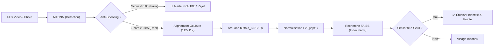

# Documentation Technique de l'Application - Système de Reconnaissance Faciale & Pointage

**Développé par :** Mvemba Dieu Merci | https://dieumercimvemba.web.app  
*(Exemple et cas d'usage concret : Université Catholique du Congo - UCC)*

---

## 📋 Table des matières

1. [Vue d'ensemble](#vue-densemble)
2. [Architecture de l'application](#architecture-de-lapplication)
3. [Écrans de l'application](#écrans-de-lapplication)
4. [Services Backend](#services-backend)
5. [Système de Reconnaissance Faciale](#système-de-reconnaissance-faciale)
6. [Graphiques Professionnels](#graphiques-professionnels)
7. [Base de Données](#base-de-données)
8. [Configuration](#configuration)
9. [Bouton de Redémarrage](#bouton-de-redémarrage)
10. [Sidebar (Barre latérale)](#sidebar-barre-latérale)
11. [Flux de travail typique](#flux-de-travail-typique)
12. [Design et UX](#design-et-ux)
13. [Sécurité](#sécurité)
14. [Performance](#performance)
15. [Dépannage](#dépannage)
16. [Notes de développement](#notes-de-développement)
17. [Améliorations futures](#améliorations-futures)
18. [Support & Auteur](#support--auteur)

---

## 🎯 Vue d'ensemble

Cette application est un système complet de gestion d'assiduité et de pointage biométrique automatique par reconnaissance faciale, développé par **Mvemba Dieu Merci** (avec l'Université Catholique du Congo - UCC pris comme exemple et cas d'usage concret pour créer une solution professionnelle aboutie). Conçue autour d'une architecture orientée services et d'une interface desktop moderne sous **Kivy**, elle associe vision par ordinateur sur flux continu, intelligence artificielle embarquée et gestion relationnelle transactionnelle :

- **Interface Desktop Moderne (Kivy)** : Expérience utilisateur réactive, fluide et modulaire, remplaçant les interfaces obsolètes ou basiques.
- **Reconnaissance faciale en temps réel** : Pipeline associant détection MTCNN, alignement oculaire géométrique et extraction d'embeddings 512-D via InsightFace ArcFace (`buffalo_l`).
- **Détection anti-spoofing active** : Barrière amont de vivacité (Liveness Detection) basée sur le réseau CNN Silent-Face v2 ONNX pour bloquer les fraudes par photo, écran ou vidéo.
- **Persistance vectorielle locale (FAISS)** : Indexation par produit scalaire (`IndexFlatIP`) assurant une recherche sub-milliseconde $O(1)$ dans l'espace latent normalisé.
- **Base de données relationnelle MySQL** : Modélisation complète (`students`, `attendance`, `faculties`, `promotions`, `users`, `reports`, `settings`) avec mode dégradé/hors-ligne automatique.
- **Graphiques décisionnels intégrés** : Moteur de visualisations analytiques basé sur Matplotlib (tendances 7 jours, jauges de présence, distributions horaires, répartition par faculté/promotion).
- **Règles de gestion d'assiduité** : Règle anti-doublon journalier, seuil horaire paramétrable pour la détection automatique des retards, et calcul déductif des absences.

---

## 🏗️ Architecture de l'application

L'architecture sépare rigoureusement la couche de présentation (Kivy), la couche de services métier et la couche de vision par ordinateur :

### Structure des fichiers

```
d:\cnn_sys\
├── .env                              # Paramètres d'environnement et credentials MySQL
├── requirements.txt                  # Dépendances Python (Kivy, OpenCV, InsightFace, etc.)
├── README.md                         # Documentation générale du projet
├── DOCUMENTATION_APPLICATION.md      # Spécifications fonctionnelles et techniques complètes
├── Dataset/                          # Clichés sources des étudiants pour enrôlement
├── docs/                             # Documents de conception et nomenclature de l'organisation
├── reports/                          # Feuilles de présence générées en CSV/Excel
├── temp_charts/                      # Rendu des graphiques Matplotlib pour le Dashboard
└── camera_system/                    # Noyau biométrique et application Kivy
    ├── config/
    │   └── settings.json             # Configuration dynamique des seuils et paramètres
    ├── data/
    │   ├── facerec_faiss.index       # Index vectoriel binaire FAISS (embeddings 512-D)
    │   └── students_metadata.pkl     # Métadonnées locales sérialisées
    ├── models/
    │   └── silent_face_v2.onnx       # Poids ONNX du modèle Anti-Spoofing Silent-Face v2
    ├── config.py                     # Wrapper Python de chargement de l'environnement (.env)
    ├── pipeline.py                   # Pipeline de vision (MTCNN + Alignement + ArcFace)
    ├── vector_db.py                  # Module d'abstraction FAISS (IndexFlatIP + pickle)
    ├── anti_spoof.py                 # Inférence de vivacité ONNX (Silent-Face v2)
    ├── realtime_detector.py          # Moteur de streaming et boucle de détection vidéo
    ├── enroll.py                     # Script d'enrôlement CLI & pointage sur photo de groupe
    ├── camera_attendance.py          # Session autonome de pointage vidéo
    ├── capture_photo.py              # Utilitaire de prise de clichés webcam
    ├── enrollment_gui.py             # Interface d'enrôlement alternative historique (Tkinter)
    └── kivy_app/                     # Application Kivy principale
        ├── main.py                   # Point d'entrée de l'application Kivy & ScreenManager
        ├── init_mysql.py             # Script de migration et d'amorçage de la base MySQL
        ├── batch_enroll.py           # Enrôlement automatique en lot depuis le Dataset
        ├── clear_database.py         # Réinitialisation sécurisée des données
        ├── screens/                  # Écrans fonctionnels Kivy
        │   ├── dashboard_screen.py   # Tableau de bord analytique et indicateurs clés
        │   ├── students_screen.py    # Annuaire, recherche et gestion des étudiants
        │   ├── enrollment_screen.py  # Formulaire d'enrôlement avec sélection d'images
        │   ├── attendance_screen.py  # Pointage caméra interactif en temps réel
        │   ├── organization_screen.py# Gestion des structures (Facultés & Promotions)
        │   ├── reports_screen.py     # Consultation et surveillance des feuilles de présence
        │   └── settings_screen.py    # Configuration des seuils (reconnaissance, spoof, caméra)
        ├── services/                 # Services métier et persistance
        │   ├── database_service.py   # Façade d'accès haut niveau aux données
        │   ├── mysql_service.py      # Connecteur CRUD direct MySQL (1100+ lignes)
        │   ├── face_recognition_service.py # Pont Kivy vers FacePipeline
        │   ├── attendance_service.py # Logique de pointage et marquage des présences
        │   ├── chart_service.py      # Génération asynchrone des graphiques Matplotlib
        │   ├── report_analytics_service.py # Statistiques quantitatives sur les rapports
        │   └── report_watcher_service.py   # Thread de surveillance du dossier reports/
        ├── widgets/                  # Composants visuels réutilisables
        │   ├── sidebar.py            # Menu latéral persistant avec KPIs dynamiques
        │   ├── header.py             # Bandeau d'en-tête institutionnel
        │   ├── ucc_button.py         # Boutons stylisés selon la charte graphique
        │   └── chart_image.py        # Widget d'affichage des graphiques dynamiques
        └── temp_charts/              # Cache local des graphiques générés pour l'application
```

---

## 📱 Écrans de l'application

L'application Kivy s'articule autour d'un `ScreenManager` orchestrant 7 écrans métier :

### 1. Dashboard (Tableau de bord)

**Fichier :** `screens/dashboard_screen.py`

**Fonctionnalités :**
- **Indicateurs clés (KPI Cards) :**
  - Total Étudiants inscrits
  - Présents Aujourd'hui
  - Retards constatés (pointage au-delà du seuil horaire configuré)
  - Taux Global de Présence (%)
- **Graphiques Décisionnels Matplotlib intégrés :**
  - 📊 Tendance de présence sur 7 jours (barres comparatives Présents / Absents)
  - 📈 Courbe d'évolution du taux de présence quotidien
  - ⏰ Distribution horaire des pointages (identification des flux d'arrivée)
  - 🥧 Répartition circulaire Présents / Retards / Absents
- **Actions Rapides :**
  - 👥 Ajouter Étudiant (redirection vers Enrôlement)
  - 📸 Démarrer Pointage (redirection vers Caméra)
  - 📊 Générer Rapport d'émargement
  - 🔄 Redémarrer Système (réinitialisation propre des connexions)
- **Flux des Derniers Pointages :** Visualisation en temps réel des derniers étudiants authentifiés avec photo miniature, nom, matricule et heure.

**Fonctionnement technique :**
1. À l'affichage (`on_enter`), le tableau de bord interroge `DatabaseService.get_statistics()`.
2. Si MySQL est temporairement indisponible, le service fournit les statistiques dégradées depuis FAISS et les fichiers locaux.
3. Il sollicite `ChartService` pour générer les images PNG dans `temp_charts/` avec le backend non-bloquant `Agg`.
4. Kivy recharge les textures graphiques dynamiquement sans interruption du thread principal.

---

### 2. Students Screen (Gestion des étudiants)

**Fichier :** `screens/students_screen.py`

**Fonctionnalités :**
- **Annuaire centralisé :** Visualisation des étudiants avec matricule, nom, prénom, promotion, faculté et nombre de clichés biométriques.
- **Filtres & Recherche instantanée :** Filtrage combiné par faculté, promotion et saisie texte (nom ou matricule).
- **Opérations CRUD complètes :**
  - Consultation de la fiche étudiant détaillée.
  - Modification des coordonnées (nom, prénom, email, téléphone, faculté, promotion).
  - Suppression d'un étudiant avec mise à jour synchronisée dans MySQL et dans l'index FAISS.
- **Statut de présence du jour :** Indicateur visuel rapide (Présent / Absent) pour la session courante.

---

### 3. Enrollment Screen (Enrôlement biométrique)

**Fichier :** `screens/enrollment_screen.py`

**Fonctionnalités :**
- **Enrôlement multi-photos assisté :** Permet la sélection d'un jeu de clichés (5 à 10 photos recommandées) représentant l'étudiant sous différents angles (face, profil léger, expressions).
- **Formulaire d'identité complet :** Saisie du matricule unique, nom, prénom, email, téléphone, sélection de la faculté et de la promotion via des listes déroulantes.
- **Validation biométrique :** Contrôle de la détectabilité du visage par MTCNN avant soumission.
- **Double persistance automatique :**
  - Extraction des embeddings 512-D par ArcFace pour chaque photo.
  - Calcul de l'embedding moyen barycentrique normalisé ($L_2$).
  - Insertion dans l'index FAISS `facerec_faiss.index` et `students_metadata.pkl`.
  - Insertion des données administratives dans la table MySQL `students`.

---

### 4. Attendance Screen (Pointage caméra en direct)

**Fichier :** `screens/attendance_screen.py`

**Fonctionnalités :**
- **Flux vidéo continu :** Intégration du composant Kivy Camera / OpenCV optimisé en résolution 1280x720.
- **Détection multi-visages simultanée :** Capacité à identifier plusieurs étudiants dans le champ de la caméra.
- **Barrière Anti-Spoofing (Liveness Detection) :** Analyse instantanée par Silent-Face v2 ONNX. Les tentatives de fraude (écrans, photos imprimées) sont encadrées en rouge vif avec la mention `SPOOF / PHOTO` et immédiatement court-circuitées.
- **Reconnaissance faciale ArcFace & FAISS :** Recherche vectorielle par produit scalaire sur l'espace normalisé (seuil configurable, défaut : `0.50`).
- **Gestion des règles d'assiduité :**
  - Application d'un cooldown de 3 secondes pour éviter les pointages saccadés d'un même étudiant.
  - Détection automatique de la ponctualité : classement en `Présent` ou `Retard` en fonction de l'heure limite fixée (`08:00`).
  - Blocage des doublons journaliers.
- **Enregistrement transactionnel :** Écriture immédiate dans la table MySQL `attendance` avec score de similarité, horodatage précis et identifiant de la caméra.

---

### 5. Organization Screen (Organisation)

**Fichier :** `screens/organization_screen.py`

**Fonctionnalités :**
- **Gestion des Facultés :** Visualisation et organisation des facultés (Médecine, Droit, Économie, Théologie, Philosophie, Communications Sociales, Informatique, Sciences Politiques, etc.).
- **Gestion des Promotions :** Niveaux d'études (L1, L2, L3, M1, M2).
- **Rapprochement organisationnel :** Association directe entre étudiants, facultés et promotions pour permettre des synthèses d'assiduité par filière.

---

### 6. Reports Screen (Rapports & Feuilles d'émargement)

**Fichier :** `screens/reports_screen.py`

**Fonctionnalités :**
- **Surveillance automatique en arrière-plan :** Intégration du service `ReportWatcherService` surveillant en continu le dossier des rapports (`reports/`).
- **Chargement réactif :** Tout nouveau fichier CSV ou Excel généré lors d'une session caméra ou importé manuellement est automatiquement indexé et consultable.
- **Visualisation tabulaire :** Affichage de la feuille d'émargement détaillée (Matricule, Nom, Prénom, Statut, Heure de passage, Confiance biométrique).
- **Analyses statistiques :** Calcul du taux de présence du rapport et récapitulatif synthétique via `ReportAnalyticsService`.

---

### 7. Settings Screen (Configuration & Paramètres système)

**Fichier :** `screens/settings_screen.py`

**Fonctionnalités :**
- **Seuil de similarité biométrique :** Ajustement fin du seuil de reconnaissance cosinus (recommandé : `0.50`).
- **Seuil de vivacité Anti-Spoofing :** Réglage de la sensibilité du modèle Silent-Face (défaut : `0.85`).
- **Configuration caméra :** Sélection de l'index matériel du périphérique vidéo (Webcam interne `0`, USB `1`, etc.).
- **Règles d'assiduité :** Définition de l'heure limite de ponctualité (ex: `08:00`), activation/désactivation de la détection automatique des retards et du calcul des absences.
- **Persistance :** Sauvegarde immédiate dans `camera_system/config/settings.json`.

---

## 🔧 Services Backend

L'application repose sur une couche de services indépendants et fortement découplés :

### DatabaseService

**Fichier :** `services/database_service.py`  
**Rôle :** Façade d'accès haut niveau assurant l'orchestration entre l'interface utilisateur Kivy et la couche de persistance MySQL.
- Fournit des méthodes unifiées : `get_statistics()`, `get_all_students()`, `find_student_by_matricule()`, `find_student_by_id()`, `record_attendance()`.
- Gère la tolérance aux pannes : bascule automatiquement en mode dégradé (fichiers locaux FAISS/CSV) si MySQL n'est pas joignable.

### MySQLService

**Fichier :** `services/mysql_service.py`  
**Rôle :** Connecteur relationnel complet assurant les opérations transactionnelles ACID avec le serveur MySQL :
- Création automatique du schéma de base de données (`create_database()`, `create_tables()`).
- Gestion du cycle de vie des connexions (`connect()`, `disconnect()`).
- Opérations CRUD paramétrées prévenant toute injection SQL sur les 7 tables du système (`users`, `faculties`, `promotions`, `students`, `attendance`, `reports`, `settings`).

### FaceRecognitionService

**Fichier :** `services/face_recognition_service.py`  
**Rôle :** Pont entre l'interface Kivy et le pipeline de vision par ordinateur [`FacePipeline`](file:///d:/cnn_sys/camera_system/pipeline.py) :
- Extraction unitaire et multiple d'embeddings à partir de fichiers images.
- Calcul mathématique de l'embedding moyen normalisé pour les inscriptions multi-photos.

### AttendanceService

**Fichier :** `services/attendance_service.py`  
**Rôle :** Traitement des événements de présence en direct :
- Vérification de la correspondance faciale avec la base vectorielle FAISS.
- Enregistrement des pointages et production automatisée des feuilles d'émargement au format CSV.

### ChartService

**Fichier :** `services/chart_service.py`  
**Rôle :** Génération de visualisations analytiques basées sur Matplotlib :
- Configuration du backend non-interactif `matplotlib.use('Agg')` pour préserver la réactivité de l'application Kivy.
- Génération des 5 visualisations fondamentales : tendance sur 7 jours, taux d'assiduité journalier, profil horaire des entrées, répartition par faculté et par promotion.
- Rendu au format PNG haute résolution dans `temp_charts/`.

### ReportWatcherService & ReportAnalyticsService

**Fichiers :** `services/report_watcher_service.py` & `services/report_analytics_service.py`  
**Rôle :** Surveillance threadée asynchrone des répertoires de rapports pour indexer automatiquement les nouveaux fichiers sans bloquer l'interface, et calcul de statistiques descriptives.

---

## 🤖 Système de Reconnaissance Faciale

Le pipeline biométrique a été conçu selon les standards les plus exigeants de la vision par ordinateur :



1. **Détection faciale (MTCNN) :**
   - Réseau convolutif à trois étages (P-Net, R-Net, O-Net) détectant simultanément plusieurs visages et localisant les 5 points clés faciaux (œil gauche, œil droit, nez, commissures des lèvres).
2. **Alignement géométrique :**
   - Calcul de l'angle de rotation à partir des repères oculaires.
   - Transformation affine (`cv2.warpAffine`) redressant le visage sur un plan horizontal strictly centré.
   - Redimensionnement standard en $112 \times 112$ pixels.
3. **Extraction d'embeddings (ArcFace) :**
   - Modèle Deep Learning InsightFace ArcFace (`buffalo_l`).
   - Projection du visage dans un espace vectoriel de 512 dimensions.
   - **Normalisation $L_2$ systématique :** chaque vecteur $v$ est ramené à une norme unitaire ($\|v\|_2 = 1.0$), garantissant que le produit scalaire équivaut exactement à la similarité cosinus.
4. **Recherche vectorielle (FAISS) :**
   - Emploi de `faiss.IndexFlatIP(512)` encapsulé dans `faiss.IndexIDMap`.
   - Complexité de recherche sub-milliseconde même pour des dizaines de milliers d'empreintes.
5. **Barrière Anti-Spoofing (Silent-Face v2 ONNX) :**
   - Modèle convolutif léger analysant les micro-textures, les reflets et les discontinuités de profondeur dans un cadre élargi ($2.7\times$).
   - Rejet immédiat si le score de vivacité est inférieur à `0.85`.

---

## 📊 Graphiques Professionnels

Le module `ChartService` génère des graphiques clairs et directement exploitables pour le pilotage pédagogique :

1. **Tendance d'assiduité sur 7 jours (Barres groupées) :** Comparatif quotidien Présents vs Absents avec étiquettes de valeurs chiffrées.
2. **Évolution du taux de présence (Courbe & Remplissage) :** Dynamique temporelle avec mise en relief des pics et baisses de participation.
3. **Distribution horaire des arrivées (Histogramme) :** Analyse de la ponctualité par créneaux horaires.
4. **Répartition quotidienne (Diagramme circulaire) :** Synthèse visuelle Présents / Retards / Absents.
5. **Taux de présence par Faculté et Promotion (Barres horizontales) :** Évaluation comparative de l'assiduité par filière.

---

## 🗄️ Base de Données

Le système exploite le SGBD MySQL (base `ucc_face_recognition`) avec le schéma relationnel suivant :

```sql
-- Table des facultés
CREATE TABLE faculties (
    id INT AUTO_INCREMENT PRIMARY KEY,
    nom VARCHAR(100) UNIQUE NOT NULL,
    code VARCHAR(20) UNIQUE NOT NULL,
    description TEXT,
    date_creation DATETIME DEFAULT CURRENT_TIMESTAMP
);

-- Table des promotions
CREATE TABLE promotions (
    id INT AUTO_INCREMENT PRIMARY KEY,
    nom VARCHAR(50) UNIQUE NOT NULL,
    code VARCHAR(20) UNIQUE NOT NULL,
    description TEXT,
    date_creation DATETIME DEFAULT CURRENT_TIMESTAMP
);

-- Table des étudiants
CREATE TABLE students (
    id INT AUTO_INCREMENT PRIMARY KEY,
    matricule VARCHAR(50) UNIQUE NOT NULL,
    nom VARCHAR(100) NOT NULL,
    prenom VARCHAR(100) NOT NULL,
    email VARCHAR(100),
    telephone VARCHAR(20),
    faculte_id INT,
    promotion_id INT,
    photo_path VARCHAR(255),
    embedding_path VARCHAR(255),
    num_photos INT DEFAULT 0,
    date_creation DATETIME DEFAULT CURRENT_TIMESTAMP,
    FOREIGN KEY (faculte_id) REFERENCES faculties(id) ON DELETE SET NULL,
    FOREIGN KEY (promotion_id) REFERENCES promotions(id) ON DELETE SET NULL
);

-- Table des présences
CREATE TABLE attendance (
    id INT AUTO_INCREMENT PRIMARY KEY,
    student_id INT NOT NULL,
    date_presence DATETIME NOT NULL,
    statut ENUM('present', 'absent', 'retard') DEFAULT 'present',
    methode ENUM('facial', 'manuel', 'qrcode') DEFAULT 'facial',
    confiance FLOAT DEFAULT 0.0,
    photo_capture_path VARCHAR(255),
    camera_id VARCHAR(50),
    notes TEXT,
    date_creation DATETIME DEFAULT CURRENT_TIMESTAMP,
    FOREIGN KEY (student_id) REFERENCES students(id) ON DELETE CASCADE
);
```

---

## ⚙️ Configuration

### Fichier `camera_system/config/settings.json`

Permet l'ajustement dynamique des paramètres au runtime :

```json
{
    "threshold": 0.5,
    "spoof_threshold": 0.85,
    "camera_index": 0,
    "resolution": "1280x720",
    "session_duration": 60,
    "cooldown": 3.0,
    "anti_spoof_enabled": true,
    "debug_mode": false,
    "attendance_rules": {
        "late_time_limit": "08:00",
        "enable_auto_late_detection": true,
        "enable_daily_duplicate_check": true,
        "enable_auto_absence_calculation": true
    }
}
```

---

## 🔄 Bouton de Redémarrage

**Emplacement :** Application Kivy → Sidebar → Section "Actions Rapides"

**Fonctionnalité :**
- Libère les flux vidéo OpenCV et ferme proprement la connexion MySQL.
- Arrête l'application Kivy via `App.get_running_app().stop()`.
- Relance un processus Python propre en arrière-plan via `subprocess.Popen`.
- Permet l'actualisation à chaud après modification de code ou de configuration.

---

## 📱 Sidebar (Barre latérale)

**Fichier :** `widgets/sidebar.py`

**Fonctionnalités :**
- Menu persistant permettant de basculer instantanément entre les 7 écrans Kivy.
- Bloc statistique dynamique affichant en temps réel le nombre d'étudiants inscrits et de présents du jour.
- Rafraîchissement automatique non-bloquant via `Clock.schedule_interval`.

---

## 🚀 Flux de travail typique

### 1. Enrôlement initial de l'étudiant
1. Accéder à l'écran **Enrôlement** dans l'application Kivy.
2. Saisir l'identité complète (Matricule, Nom, Prénom, Faculté, Promotion).
3. Sélectionner un lot de photos d'identité de qualité.
4. Cliquer sur **Enrôler l'étudiant** : extraction automatique, calcul du vecteur centroïde, enregistrement dans FAISS et dans MySQL.

### 2. Pointage automatique en début de cours
1. Ouvrir l'écran **Pointage Caméra** et démarrer la session.
2. Les étudiants se présentent successivement ou en groupe devant l'objectif.
3. Le modèle Silent-Face vérifie la vivacité en amont.
4. Les visages authentiques sont comparés à la base FAISS.
5. Dès validation, l'étudiant est notifié à l'écran et la présence est inscrite dans MySQL avec qualification ponctualité/retard.

### 3. Consultation décisionnelle & Rapports
1. Consulter le **Dashboard** pour suivre les jauges de présence et les distributions horaires.
2. Accéder à l'écran **Rapports** pour exporter la feuille de présence horodatée au format CSV.

---

## 🎨 Design et UX

L'interface Kivy applique une charte graphique sobre, institutionnelle et ergonomique :

- **UCC_BLUE (#1E3A5F)** : Couleur identitaire principale (bandeau, éléments majeurs).
- **ACCENT_BLUE (#4A90E2)** : Boutons d'actions et liens actifs.
- **SUCCESS_GREEN (#28A745)** : Validation de présence et succès d'enrôlement.
- **WARNING_YELLOW (#FFC107)** : Alertes de retard ou avertissements.
- **DANGER_RED (#DC3545)** : Détection de fraude (`SPOOF / PHOTO`) et suppressions.
- **BACKGROUND (#F8F9FA)** : Fond clair reposant optimisé pour un usage prolongé.

---

## 🔒 Sécurité

- **Détection Anti-Fraude (Liveness)** : Impossibilité d'émarger avec un cliché photographique imprimé, une vidéo ou un écran de smartphone.
- **Absence de Fuite Cloud** : Tout le traitement s'exécute localement (Air-Gapped), sans transmission de descripteurs biométriques sur des serveurs tiers.
- **Embeddings Irréversibles** : Le vecteur ArcFace 512-D constitue une projection unidirectionnelle à partir de laquelle il est impossible de reconstruire la photo originale.

---

## 📈 Performance

| Opération | Durée moyenne | Remarques |
| :--- | :--- | :--- |
| Détection MTCNN | ~35 - 50 ms | Optimisée CPU multi-threads |
| Inférence Anti-Spoofing | ~15 - 20 ms | OpenCV DNN sur modèle ONNX |
| Alignement géométrique | ~5 - 10 ms | Transformation affine par points clés |
| Extraction ArcFace | ~25 - 35 ms | Modèle `buffalo_l` |
| Recherche vectorielle FAISS | < 2 ms | Recherche $O(1)$ par produit scalaire |
| **Temps total par visage** | **~85 - 115 ms** | **Permet un traitement temps réel fluide (10-15 FPS)** |

---

## 🐛 Dépannage

- **Échec de connexion MySQL :** Vérifiez que le service local MySQL tourne sur le port `3306` et que le fichier `.env` comporte les bons identifiants. Si besoin, lancez `python kivy_app/init_mysql.py`.
- **Caméra inaccessible :** Vérifiez qu'aucune autre application (Teams, Zoom, navigateur) n'utilise la caméra, ou testez l'index `1` dans `settings.json`.
- **Similarité trop faible lors de la reconnaissance :** Assurez-vous que l'étudiant a été enrôlé avec plusieurs photos sous un bon éclairage. Vous pouvez abaisser légèrement le seuil à `0.45` via l'écran Paramètres.
- **Faux positifs Anti-Spoofing :** Évitez les contre-jours directs ou les éclairages fluorescents clignotants derrière le sujet.

---

## 📝 Notes de développement

- **Conception modulaire :** Remplacement des architectures monolithiques par des services autonomes (`DatabaseService`, `ChartService`, `FaceRecognitionService`).
- **Normalisation $L_2$ systématique :** Correction appliquée dans `vector_db.py` assurant une rigueur mathématique stricte entre produit scalaire et similarité cosinus.
- **Intégration Kivy asynchrone :** Découplage des tâches d'inférence lourde pour préserver la réactivité de la boucle d'événements principale Kivy.

---

## 🚧 Améliorations futures

- [ ] Export direct des feuilles d'émargement au format PDF officiel avec signature numérique.
- [ ] Notifications automatiques par SMS / Email aux étudiants retardataires ou absents.
- [ ] Prise en charge multi-caméras pour les grands amphithéâtres.
- [ ] Module d'authentification biométrique 2FA combinant QR Code étudiant et reconnaissance faciale.

---

## 📞 Support & Auteur

Pour toute question technique, contribution ou demande d'évolution sur ce système :

**Auteur & Concepteur :**  
**Mvemba Dieu Merci**  
🌐 Site web & Portfolio : [https://dieumercimvemba.web.app](https://dieumercimvemba.web.app)  

---

**Version du système :** 1.0.0  
**Dernière mise à jour :** 1 Novembre 2026  
**Développé par :** Mvemba Dieu Merci | https://dieumercimvemba.web.app
